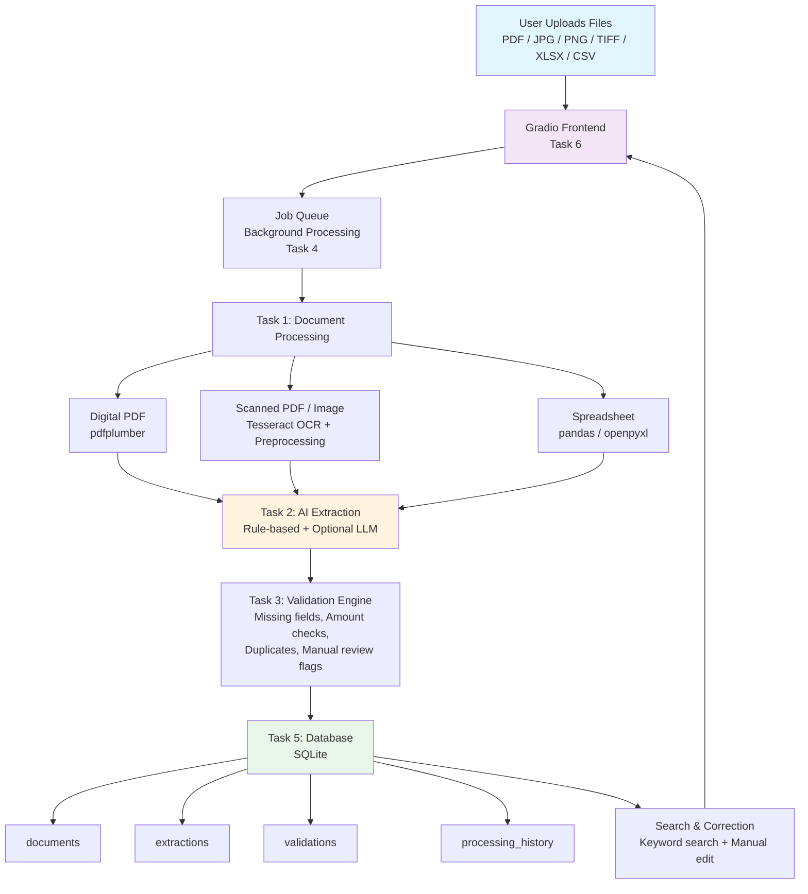

# Architecture Diagram



## Database Schema

```sql
-- documents
CREATE TABLE documents (
    id              TEXT PRIMARY KEY,
    original_name   TEXT NOT NULL,
    file_type       TEXT,
    status          TEXT DEFAULT 'pending',
    uploaded_at     TEXT,
    processed_at    TEXT,
    processing_time REAL,
    page_count      INTEGER DEFAULT 0,
    full_text       TEXT,
    error_message   TEXT
);

-- extractions
CREATE TABLE extractions (
    id              TEXT PRIMARY KEY,
    document_id     TEXT REFERENCES documents(id),
    invoice_number  TEXT,
    invoice_date    TEXT,
    supplier_name   TEXT,
    customer_name   TEXT,
    subtotal        REAL,
    tax_amount      REAL,
    total           REAL,
    currency        TEXT,
    extracted_json  TEXT,
    created_at      TEXT
);

-- validations
CREATE TABLE validations (
    id                  TEXT PRIMARY KEY,
    document_id         TEXT REFERENCES documents(id),
    is_valid            INTEGER,
    needs_manual_review INTEGER,
    score               REAL,
    errors_json         TEXT,
    warnings_json       TEXT,
    created_at          TEXT
);

-- processing_history
CREATE TABLE processing_history (
    id          TEXT PRIMARY KEY,
    document_id TEXT,
    event       TEXT,
    details     TEXT,
    created_at  TEXT
);
```
